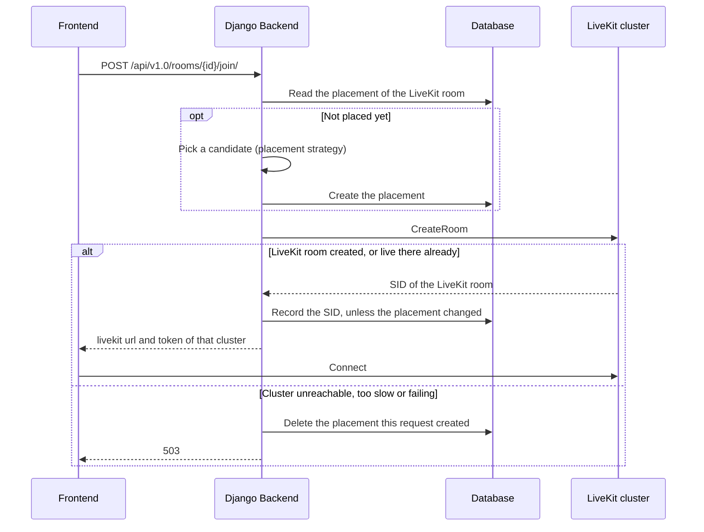
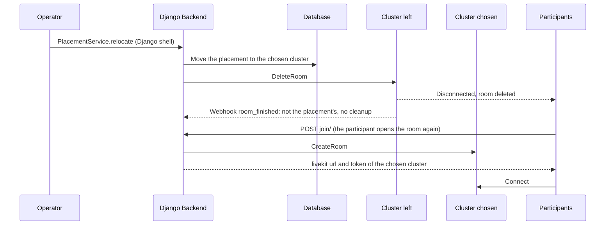

# Multi-cluster LiveKit

La Suite Meet can spread its rooms over several independent LiveKit clusters. The Django backend chooses the cluster of each room: the first time it hands out LiveKit credentials for a room, it places the room's LiveKit room on one cluster, creates the LiveKit room there, and hands out a URL and a token for that cluster only. Everyone joining the room afterwards is sent to the same cluster, so its participants are never split between LiveKit rooms.

A deployment with a single LiveKit cluster runs the same code, see [With a single cluster](#with-a-single-cluster).

**Current Limitations**:

* Telephony (`ROOM_TELEPHONY_ENABLED`) and roomkit (`ROOMKIT_ENABLED`) need a single cluster: the backend refuses to start with either of them and more than one cluster in `LIVEKIT_CLUSTERS`. Phone and roomkit callers reach the SIP server of one cluster before their PIN tells which room they join, so the backend cannot send them to the cluster the room is placed on.
* Relocating a room is only possible from the Django shell, and disconnects its participants, who land on the page shown when a room is deleted and have to open the room again, see [Relocating a room](#relocating-a-room).
* Unregistered rooms (`ALLOW_UNREGISTERED_ROOMS`) all live on the default cluster: they are neither spread over the clusters nor relocated, and cannot be joined while the default cluster is down.
* A room placed on a cluster that is down cannot be joined until it is relocated: its placement only ends with the `room_finished` webhook of that cluster, so every join answers a `503` meanwhile, see [A cluster is down](#a-cluster-is-down).

## Vocabulary

* **LiveKit cluster**: one LiveKit deployment, with its own URL, API key and secret. Its nodes share a Redis, but two clusters share nothing.
* **Registry**: the clusters the backend knows, listed in `LIVEKIT_CLUSTERS`. The first one is the **default cluster**.
* **Room**: a room of Meet. **LiveKit room**: the LiveKit room of a meeting, named after the id of its room, which lives on one cluster.
* **Placement**: the record, in the database, of the cluster a LiveKit room lives on. It lasts from the first credentials handed out for the LiveKit room until the LiveKit room finishes.
* **Candidate**: a registered cluster that may receive new placements, that is whose weight is above 0.
* **Placement strategy**: the rule picking the cluster of a new placement among the candidates.
* **Relocation**: moving the placement of a room to another cluster, and closing its LiveKit room on the cluster it leaves.

## How it works

### Joining a room

Each time the backend hands out LiveKit credentials for a room, through `POST /api/v1.0/rooms/{id}/join/`, or `request-entry/` when it lets the participant in, it:

1. reads the placement of the room's LiveKit room, or places it on the cluster the placement strategy picks among the candidates. A placement on a cluster that is no longer registered is deleted, and the LiveKit room placed again;
2. creates the LiveKit room on that cluster. A LiveKit room live there already is kept as it is. No metadata is sent, as the cluster would store it in place of a live LiveKit room's;
3. records the SID of the LiveKit room on the placement, as long as the placement did not change meanwhile, as when a relocation moved it: otherwise it reads the placement again and starts over, once;
4. hands out the URL browsers reach that cluster at, and a token signed with that cluster's API key.



The request is answered with a `503`, `{"detail": "This room cannot be joined for now, please try again."}`:

* when no cluster may receive the room, as when every cluster weighs 0.
* when its cluster fails to create the LiveKit room: it cannot be reached, does not answer in time or answers with an error. A placement created by the request is deleted, as nobody was handed out credentials for it, so the next attempt may place the room on another cluster. An older placement stays, and the next attempt tries the same cluster again;
* when its placement keeps changing while the LiveKit room is created.

The roomkit join places the room and creates its LiveKit room the same way, as a meeting-room device may be its first participant.

An unregistered room is never placed, since the backend does not follow its lifecycle: `LIVEKIT_WEBHOOK_EVENTS_FILTER_REGEX` usually filters its webhooks out. Its LiveKit room is created on the default cluster, and its credentials are for that cluster.

The connection test (`CONNECTION_TEST_ENABLED`) creates its LiveKit room on the cluster the placement strategy picks, without placement, as nobody else ever joins it. It answers a `503` when that cluster fails to create it, as it tries no other, and with Celery its LiveKit room is deleted later on that same cluster.

### Placement strategies

`LIVEKIT_PLACEMENT_STRATEGY` reference the placement strategy:

| Strategy | Picks |
|---|---|
| `core.livekit.strategies.WeightedRandomStrategy` (default) | A candidate at random, with a probability proportional to its weight: with weights of 1 and 3, the second cluster receives three quarters of the new rooms |
| `core.livekit.strategies.RoundRobinStrategy` | The candidates in turn, whatever their weights. Turns are counted in the Django cache, which all backend processes share |
| `core.livekit.strategies.LeastPlacementsStrategy` | The candidate holding the fewest placements for its weight, the one registered first on a tie. Rooms placed at the same moment may all go to the same cluster |

A cluster weighing 0 is no candidate: it keeps its live rooms and receives no new placement.

A strategy is a subclass of `core.livekit.strategies.PlacementStrategy`, whose `choose(candidates, context)` returns one of the candidates. The context gives the name of the LiveKit room and its room, or `None` for a connection test.

### Managing a live room

Everything the backend does to a live LiveKit room is done on the cluster of its placement: updating its metadata when the room's configuration changes, managing its participants, dispatching the subtitle agent, and closing it when the room is deleted.

Every cluster sends its webhooks to `/api/v1.0/rooms/webhooks-livekit/`, signed with its own API key. The backend tells which cluster sent a webhook by the API key that signed it, which is why every cluster needs an API key of its own. Requests authenticated with a LiveKit token (`X-LiveKit-Token`) are checked the same way.

When a LiveKit room finishes (`room_finished`), its placement is deleted, but only when the placement is on the cluster that sent the webhook and has the SID of the LiveKit room that finished. Otherwise the room has moved on to another LiveKit room since, created again or relocated, which participants may be joining: the room is then not cleaned up, so its SIP dispatch rule stays and participants admitted from its lobby are not queued again. A LiveKit room without placement is cleaned up as before.

### Recordings, subtitles and agents

A recording is made on the cluster its room is placed on when the recording starts, which the recording keeps in `livekit_cluster`. Its egress is started, stopped and looked up there, its metadata collector dispatched there, and the room metadata it updates and its notifications sent there, wherever the room is placed since. A recording naming no cluster and one on a cluster that is no longer registered are managed on the default cluster.

Every cluster needs:

* its own [LiveKit Egress](recording.md)
* its own subtitle and metadata collector agents since the backend dispatches them on the cluster of the room.

Relocating a room ends its recording with the LiveKit room it leaves: the recording is saved and transcribed as usual, and recording again means starting a new one.

### Relocating a room

A relocation moves a live room off its cluster, to rebalance rooms or to empty a cluster before its maintenance. It is done from the Django shell:

```python
from core.livekit.placements import PlacementService

PlacementService.relocate("<room id>", to="lyon", actor=None)  # to a given cluster
PlacementService.relocate("<room id>", actor=None)  # to the one the strategy picks
```

`actor` is who relocates the room in the audit log: a user, or `None` for the system.

Relocating a room:

1. reads its placement and picks another candidate, the one named or else the one the placement strategy picks among the other candidates;
2. moves the placement to that cluster, as long as it did not change since it was read, and forgets its SID: the LiveKit room is created on the new cluster by the next join;
3. deletes the LiveKit room on the cluster it leaves, which disconnects its participants.




The frontend of this release does not follow a relocation yet: participants land on the page shown when a room is deleted, and get credentials for the new cluster when they open the room again.

#### A cluster is down

The rooms placed on a cluster that is down keep their placement, as only that cluster's `room_finished` webhook ends it, and every join of them answers a `503`, since the cluster cannot create their LiveKit room. Set the cluster's weight to 0, so that it receives no new room, and relocate its rooms: a relocation moves the placement without reaching the cluster left, logs and audits its failure to close the LiveKit room there, and the next join creates the LiveKit room on the new cluster. To list the rooms placed on a cluster:

```python
from core.models import Placement

Placement.objects.filter(cluster="paris").values_list("room_name", flat=True)
```

## Setup

### Registering the clusters

`LIVEKIT_CLUSTERS` lists the clusters in a simple JSON format. As it holds their API secrets, it is best read from a file, whose path `LIVEKIT_CLUSTERS_FILE` gives, such as a mounted Kubernetes secret:

```json
[
  {
    "name": "paris",
    "url": "https://livekit-paris.example.org",
    "api_key": "<paris API key>",
    "api_secret": "<paris API secret>",
    "weight": 2
  },
  {
    "name": "lyon",
    "url": "https://livekit-lyon.example.org",
    "api_url": "http://livekit-lyon.internal:7880",
    "api_key": "<lyon API key>",
    "api_secret": "<lyon API secret>"
  }
]
```

| Field | Meaning |
|---|---|
| `name` | Lowercase letters, digits and hyphens, 63 characters at most, unique. Placements and recordings record it: renaming a cluster detaches them from it |
| `url` | The URL browsers connect to, `http`, `https`, `ws` or `wss` |
| `api_url` | The URL the backend calls the LiveKit API at, `url` by default |
| `api_key`, `api_secret` | The API key and secret of the cluster. Each cluster needs an API key of its own |
| `weight` | An integer, 1 by default. 0 keeps the cluster from receiving new rooms |

The first cluster is the default one by convention.

Every backend process must have the same `LIVEKIT_CLUSTERS`: a process that does not know a cluster places again, at the next join, a room placed there, which splits it from the participants already connected. To add a cluster, register it with a weight of 0 on every process first, then raise its weight. To remove one, set its weight to 0, relocate its rooms, and remove it once none is left.

### Preparing each cluster

Every cluster needs:

* its webhooks sent to `https://<meet domain>/api/v1.0/rooms/webhooks-livekit/`, signed with its own API key
* its own egress and agents, see [Recordings, subtitles and agents](#recordings-subtitles-and-agents).

## With a single cluster

Without `LIVEKIT_CLUSTERS`, the registry holds a single cluster named `default`, built from `LIVEKIT_API_URL`, `LIVEKIT_API_KEY` and `LIVEKIT_API_SECRET`, and nothing else is to be configured. Joins still create the LiveKit room, and answer a `503` when LiveKit fails to create it within `LIVEKIT_API_TIMEOUT_SECONDS`. Room auto-creation may stay on.

## Configuration

| Option | Type | Default | Description |
|---|---|---|---|
| **LIVEKIT_CLUSTERS** | JSON | unset | The LiveKit clusters, see [Registering the clusters](#registering-the-clusters). Read from the file `LIVEKIT_CLUSTERS_FILE` names, when set. Unset, a single cluster named `default` is built from `LIVEKIT_API_URL`, `LIVEKIT_API_KEY` and `LIVEKIT_API_SECRET` |
| **LIVEKIT_PLACEMENT_STRATEGY** | String | `core.livekit.strategies.WeightedRandomStrategy` | Dotted path of the placement strategy, see [Placement strategies](#placement-strategies) |
