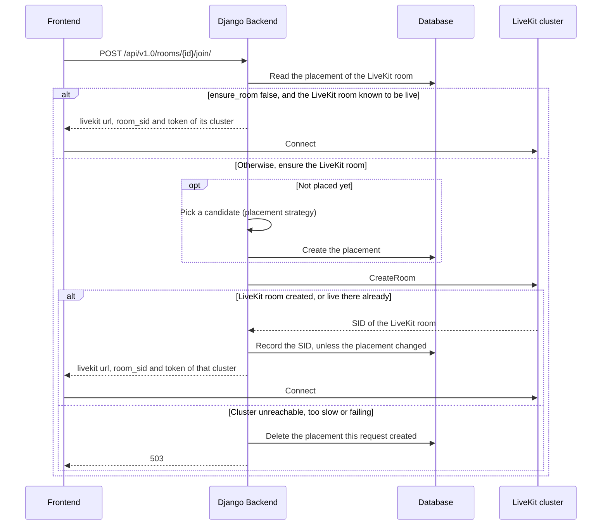
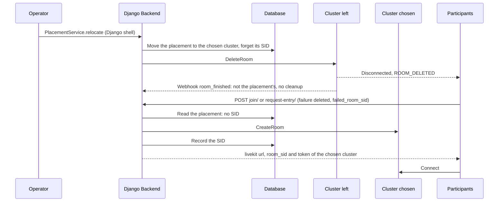

# Multi-cluster LiveKit

La Suite Meet can spread its rooms over several independent LiveKit clusters for high availability and load balancing.
The Django backend chooses the cluster of each room the first time it hands out LiveKit credentials for a room.
- It places the room's LiveKit room on one cluster
- It creates the LiveKit room there
- It hands out a URL and a token for that cluster only
- Everyone joining the room afterwards is sent to the same cluster


To avoid having participants split between LiveKit rooms, when they can't connect to the LiveKit room, the frontend asks the backend again where to connect.

A deployment with a single LiveKit cluster runs the same code, see [With a single cluster](#with-a-single-cluster).

**Current Limitations**:

* Telephony (`ROOM_TELEPHONY_ENABLED`) and roomkit (`ROOMKIT_ENABLED`) need a single cluster: the backend refuses to start with either of them and more than one cluster in `LIVEKIT_CLUSTERS`. Phone and roomkit callers reach the SIP server of one cluster before their PIN tells which room they join, so the backend cannot send them to the cluster the room is placed on.
* Relocating a room is only possible from the Django shell. It disconnects its participants, whose browsers connect to the new cluster on their own a few seconds later, in a new LiveKit room and with their microphone and camera off: the chat, subtitles and recording of the one left are not carried over, see [Relocating a room](#relocating-a-room). Frontends of earlier releases, and every frontend while `LIVEKIT_CONNECTION_RECOVERY_ENABLED` is off, land on the page shown when a room is deleted instead, and have to open the room again.
* Unregistered rooms (`ALLOW_UNREGISTERED_ROOMS`) all live on the default cluster: they are neither spread over the clusters nor relocated, and cannot be joined while the default cluster is down.
* A room placed on a cluster that is down cannot be joined until it is relocated: its placement only ends with the `room_finished` webhook of that cluster, so joins keep sending participants there, and they fail to connect, see [A cluster is down](#a-cluster-is-down).

## Vocabulary

* **LiveKit cluster**: one LiveKit deployment, with its own URL, API key and secret. Its nodes share a Redis, but two clusters share nothing.
* **Registry**: the clusters the backend knows, listed in `LIVEKIT_CLUSTERS`. The first one is the **default cluster**.
* **Room**: a room of Meet. **LiveKit room**: the LiveKit room of a meeting, named after the id of its room, which lives on one cluster.
* **SID**: the id a cluster gives a LiveKit room when it creates it. A LiveKit room created again, on the same cluster or on another, gets a new SID, which tells it from the one before.
* **Placement**: the record, in the database, of the cluster a LiveKit room lives on, and of its SID once known. It lasts from the first credentials handed out for the LiveKit room, or the first time a cluster tells the backend the LiveKit room started there, until the LiveKit room finishes.
* **Known to be live**: said of a LiveKit room whose placement records its SID.
* **Candidate**: a registered cluster that may receive new placements, that is whose weight is above 0.
* **Placement strategy**: the rule picking the cluster of a new placement among the candidates.
* **Relocation**: moving the placement of a room to another cluster, and closing its LiveKit room on the cluster it leaves.

## How it works

### Joining a room

Each time the backend hands out LiveKit credentials for a room, through `POST /api/v1.0/rooms/{id}/join/`, or `request-entry/` when it lets the participant in, it reads the placement of the room's LiveKit room. What it does next depends on what the frontend asks:

* By default, it ensures the LiveKit room exists:
  1. it places the LiveKit room, when it is not placed yet, on the cluster the placement strategy picks among the candidates. A placement on a cluster that is no longer registered is deleted, and the LiveKit room placed again
  2. it creates the LiveKit room on that cluster. A LiveKit room live there already is kept as it is.
  3. it records the SID of the LiveKit room on the placement, as long as the placement did not change meanwhile, as when a relocation moved it: otherwise it reads the placement again and decides again, once.
* With `"ensure_room": false`, which frontends of this release send while `GET /api/v1.0/config/` sets `livekit.connection_recovery`, it trusts a LiveKit room **known to be live** on a registered cluster: it hands out credentials for it without writing anything nor calling LiveKit. Otherwise, as when the room is not placed yet or its placement records no SID, it ensures the LiveKit room.

Either way, the `livekit` object of the response holds the URL browsers reach the cluster at (`url`), the name of the LiveKit room (`room`), its SID as the placement records it (`room_sid`), and a token signed with that cluster's API key (`token`).

Trusting the placement costs a join a few database reads, where creating the LiveKit room holds one of the backend's workers for up to `LIVEKIT_API_TIMEOUT_SECONDS`, and guarantees nothing anyway: CreateRoom never keeps an empty LiveKit room alive. The SID handed out without calling LiveKit may be stale, as when the LiveKit room closed and its `room_finished` webhook was lost: LiveKit then refuses the connection, and the frontend asks again, see [When a LiveKit room fails](#when-a-livekit-room-fails).



Ensuring the LiveKit room answers the request with a `503`, `{"detail": "This room cannot be joined for now, please try again."}`:

* when no cluster may receive the room, as when every cluster weighs 0.
* when its cluster fails to create the LiveKit room: it cannot be reached, does not answer in time or answers with an error. A placement created by the request is deleted, as nobody was handed out credentials for it, so the next attempt may place the room on another cluster. An older placement stays, and the next attempt tries the same cluster again;
* when its placement keeps changing while the LiveKit room is created.

The roomkit join places the room and ensures its LiveKit room the same way, as a meeting-room device may be its first participant.

An unregistered room is never placed, since the backend does not follow its lifecycle. Its LiveKit room is created on the default cluster whatever the frontend asks, unless the frontend reports it `deleted`: the answer is then a `409`, as for a room without placement, see [What the backend answers](#what-the-backend-answers).

The connection test (`CONNECTION_TEST_ENABLED`) creates its LiveKit room on the cluster the placement strategy picks, without placement, as nobody else ever joins it. It answers a `503` when that cluster fails to create it, as it tries no other, and with Celery its LiveKit room is deleted later on that same cluster.

### When a LiveKit room fails

The frontend uses the credentials it was handed out for one connection. When that connection ends, it asks the backend for credentials again, unless the participant left, joined from another device (`DUPLICATE_IDENTITY`) or was removed by a host. It asks through `join/`, or through `request-entry/` when the lobby let it in, which keeps its identity, and reports the LiveKit room that failed:

| Field | Type | Meaning |
|---|---|---|
| `ensure_room` | Boolean, `true` by default | `false` lets the backend trust a LiveKit room known to be live, see [Joining a room](#joining-a-room). Ignored when a failure is reported |
| `failed_room_sid` | String, 63 characters at most | The SID of the LiveKit room that failed: the one the frontend was connected to, else the `room_sid` of its credentials |
| `failure` | `missing` or `deleted` | `deleted` when LiveKit disconnected the frontend with the `ROOM_DELETED` reason, `missing` when LiveKit refused its connection |

`failure` and `failed_room_sid` go together: one without the other is answered with a `400`.

#### What the frontend reports

| The connection | The frontend asks with | Then |
|---|---|---|
| Ended with `ROOM_DELETED`: a relocation, a stray LiveKit room closed, a room deleted in Meet, or `lk room delete` | `deleted` and the SID it was connected to | It connects to the answer when its `room_sid` is another one. The same SID means that the meeting ended |
| Was refused by LiveKit (a `404`, `401` or `403`) before connecting | `missing` and the `room_sid` of its credentials | It connects to the answer |
| Ended otherwise: its reconnection gave up after `LIVEKIT_RECONNECT_GIVE_UP_AFTER_MS` or was refused by LiveKit, its LiveKit node shut down, its signal or media connection failed, or it timed out before connecting | `ensure_room` false, and no failure | It connects to the answer, even unchanged, and learns from LiveKit whether the LiveKit room is still there: refused, it asks again with `missing`. Only a connection that never came up is not tried again at the same URL and SID: it ends on "Unable to join the meeting", or on "The connection to the meeting was lost" for a participant who had been in the meeting |

After a failure, the backend thus creates a LiveKit room again once LiveKit itself refused it, which means that its cluster answers; after a relocation, on the cluster the room moved to; or when a frontend asks without reporting a failure while no LiveKit room is known to be live, as when its placement is gone. A cluster that is down keeps the placements it held, with the SIDs of their LiveKit rooms, as only its own `room_finished` webhook ends them: asking about those costs the backend reads of placements, not a CreateRoom per participant.

A frontend asks 3 times at most, and gets its asks back once a connection stayed up 30 seconds without reconnecting. It waits before asking, for a random delay within 1 second for a LiveKit room deleted or refused and within 3 seconds otherwise, so that the participants of a room, or of every room of a LiveKit node, do not ask at once. It asks again after a `429`, a `5xx`, a network error or 30 seconds without an answer.

A participant connected again this way comes back with the microphone and the camera off, and has to turn them on again.

#### What the backend answers

`PlacementService.place` decides on the placement it reads, and decides again on every read, when the placement changes while the LiveKit room is created:

| Asked | Placement | Answer |
|---|---|---|
| Default (`ensure_room` true) | Any | The LiveKit room is ensured |
| `ensure_room` false | Known to be live, on a registered cluster | That LiveKit room, with nothing written nor any LiveKit call |
| `ensure_room` false | None, no SID, or on a cluster no longer registered | The LiveKit room is ensured |
| `missing` | Known to be live with another SID, on a registered cluster | That LiveKit room: created again or moved since |
| `missing` | Otherwise | The LiveKit room is ensured: created again |
| `deleted` | Known to be live with another SID, on a registered cluster | That LiveKit room: relocated, closed as a stray, or a new meeting |
| `deleted` | None, or naming the SID reported | `409`, with nothing written nor any LiveKit call |
| `deleted` | Otherwise: no SID, or another SID on a cluster no longer registered | The LiveKit room is ensured, as after a relocation |

The `409` is `{"detail": "This meeting has ended."}`, and the frontend then shows "The meeting has ended", with no button to rejoin. A soft-deleted room is still answered with a `410` first, which ends on "This meeting has been deleted", and a LiveKit room that cannot be ensured with a `503`. A participant the lobby has to let in again is queued, whatever it reports.

### Placement strategies

`LIVEKIT_PLACEMENT_STRATEGY` reference the placement strategy:

| Strategy | Picks |
|---|---|
| `core.livekit.strategies.WeightedRandomStrategy` (default) | A candidate at random, with a probability proportional to its weight: with weights of 1 and 3, the second cluster receives three quarters of the new rooms |
| `core.livekit.strategies.RoundRobinStrategy` | The candidates in turn, whatever their weights. Turns are counted in the Django cache, which all backend processes share |
| `core.livekit.strategies.LeastPlacementsStrategy` | The candidate holding the fewest placements for its weight, the one registered first on a tie. Rooms placed at the same moment may all go to the same cluster |

A cluster weighing 0 is no candidate: it keeps its live rooms and receives no new placement.

A strategy is a subclass of `core.livekit.strategies.PlacementStrategy`, whose `choose(candidates, context)` returns one of the candidates. The context gives the name of the LiveKit room and its room, or `None` for a connection test.

### Managing a live room

Everything the backend does to a live LiveKit room is done on the cluster of its placement: updating its metadata when the room's configuration changes, managing its participants, dispatching the subtitle agent, and closing it when the room is deleted.

Every cluster sends its webhooks to `/api/v1.0/rooms/webhooks-livekit/`, signed with its own API key. The backend tells which cluster sent a webhook by the API key that signed it, which is why every cluster needs an API key of its own. Requests authenticated with a LiveKit token (`X-LiveKit-Token`) are checked the same way.

When a LiveKit room finishes (`room_finished`), its placement is deleted, but only when the placement is on the cluster that sent the webhook and has the SID of the LiveKit room that finished. Otherwise the room has moved on to another LiveKit room since, created again or relocated, which participants may be joining: the room is then not cleaned up.

### Recording the LiveKit rooms that start

Only the backend creates LiveKit rooms, as clusters run with room auto-creation off, see [Preparing each cluster](#preparing-each-cluster). A join racing a relocation may still create one on the cluster left. As a backstop, the backend records every LiveKit room a cluster tells has started (`room_started`), depending on the placement it reads:

* Without placement, the LiveKit room is placed on the cluster it started on, with its SID, when that cluster is a candidate. It is left alone when no cluster is a candidate, and closed otherwise.
* Placed on another registered cluster, it is closed, unless its placement, read again right before closing it, says otherwise.
* Placed on a cluster this backend process does not know, it is left alone, and so is its placement: processes may disagree on the clusters while `LIVEKIT_CLUSTERS` changes. Its start is ignored.
* Placed on its cluster, its SID is recorded when the placement records none. A SID already recorded is kept: joins record the SID of the LiveKit rooms they create, and a webhook may be late.

Closing a LiveKit room deletes it, which disconnects its participants with `ROOM_DELETED`: their frontends ask again, and follow the placement, or are told that the meeting ended when there is none.

### Recordings, subtitles and agents

A recording is made on the cluster its room is placed on when the recording starts, which the recording keeps in `livekit_cluster`. Its egress is started, stopped and looked up there, its metadata collector dispatched there, and the room metadata it updates and its notifications sent there, wherever the room is placed since. A recording naming no cluster and one on a cluster that is no longer registered are managed on the default cluster.

Every cluster needs:

* its own [LiveKit Egress](recording.md)
* its own subtitle and metadata collector agents since the backend dispatches them on the cluster of the room.

Relocating a room ends its recording with the LiveKit room it leaves: the recording is saved and transcribed as usual, and recording again means starting a new one.

### Relocating a room

A relocation moves a live room off its cluster, to rebalance rooms or to empty a cluster before its maintenance. It is done from the Django shell:

```python
from core.livekit.placements import PlacementService

PlacementService.relocate("<room id>", to="lyon", actor=None)  # to a given cluster
PlacementService.relocate("<room id>", actor=None)  # to the one the strategy picks
```

`actor` is who relocates the room in the audit log: a user, or `None` for the system.

Relocating a room:

1. reads its placement and picks another candidate, the one named or else the one the placement strategy picks among the other candidates
2. moves the placement to that cluster and cleans its SID: the next participant to ask for credentials has the LiveKit room created on the new cluster
3. deletes the LiveKit room on the cluster it leaves, which disconnects its participants with `ROOM_DELETED`.

Their frontends then ask again, reporting the LiveKit room deleted. The placement records no SID, so the backend creates the LiveKit room on the new cluster, or finds it there when another participant asked first, and hands out credentials for it: participants who ask at the same time converge on the same LiveKit room. They are connected there again a few seconds after the relocation, with their microphone and camera off.




Frontends of earlier releases, and every frontend while `LIVEKIT_CONNECTION_RECOVERY_ENABLED` is off, do not follow a relocation: their participants land on the page shown when a room is deleted, and get credentials for the new cluster when they open the room again.

#### A cluster is down

The rooms placed on a cluster that is down keep their placement, as only that cluster's `room_finished` webhook ends it. Their participants fail in their browser rather than with a `503`:

* A join trusting a LiveKit room known to be live hands out credentials for that cluster without calling it. The browser waits 5 seconds at most for the warm-up, fails to connect, asks where the room is, gets the same answer, and ends on "Unable to join the meeting".
* Participants connected when it went down keep reconnecting until their reconnection gives up, after `LIVEKIT_RECONNECT_GIVE_UP_AFTER_MS`. They then ask where the room is, without reporting a failure, fail to connect to the answer and ask once more: until the room is relocated, they get the same answer and end on "The connection to the meeting was lost".
* Only a join or an ask that ensures the LiveKit room answers a `503`, after `LIVEKIT_API_TIMEOUT_SECONDS`: that of a frontend of an earlier release or of roomkit, every join of a frontend while `LIVEKIT_CONNECTION_RECOVERY_ENABLED` is off, that of a room whose placement records no SID, and the report of a missing LiveKit room, which only follows LiveKit refusing the connection (a `404`, `401` or `403`).

You should set the problematic cluster's weight to 0 to stop it from receiving new rooms, and relocate its rooms.

To list the rooms placed on the problematic cluster:

```python
from core.models import Placement

Placement.objects.filter(cluster="paris").values_list("room_name", flat=True)
```

## Setup

### Registering the clusters

`LIVEKIT_CLUSTERS` lists the clusters in a simple JSON format. As it holds their API secrets, it is best read from a file, whose path `LIVEKIT_CLUSTERS_FILE` gives, such as a mounted Kubernetes secret:

```json
[
  {
    "name": "paris",
    "url": "https://livekit-paris.example.org",
    "api_key": "<paris API key>",
    "api_secret": "<paris API secret>",
    "weight": 2
  },
  {
    "name": "lyon",
    "url": "https://livekit-lyon.example.org",
    "api_url": "http://livekit-lyon.internal:7880",
    "api_key": "<lyon API key>",
    "api_secret": "<lyon API secret>"
  }
]
```

| Field | Meaning |
|---|---|
| `name` | Lowercase letters, digits and hyphens, 63 characters at most, unique. Placements and recordings record it: renaming a cluster detaches them from it |
| `url` | The URL browsers connect to, `http`, `https`, `ws` or `wss` |
| `api_url` | The URL the backend calls the LiveKit API at, `url` by default |
| `api_key`, `api_secret` | The API key and secret of the cluster. Each cluster needs an API key of its own |
| `weight` | An integer, 1 by default. 0 keeps the cluster from receiving new rooms |

The first cluster is the default one by convention.

Every backend process must have the same `LIVEKIT_CLUSTERS`: a process that does not know a cluster places again, at the next join, a room placed there, which splits it from the participants already connected. To add a cluster, register it with a weight of 0 on every process first, then raise its weight. To remove one, set its weight to 0, relocate its rooms, and remove it once none is left.

### Preparing each cluster

Every cluster needs:

* room auto-creation off (`room.auto_create: false` in its LiveKit configuration): only the backend creates LiveKit rooms, and a cluster creating them as participants join is not supported
* its webhooks sent to `https://<meet domain>/api/v1.0/rooms/webhooks-livekit/`, signed with its own API key
* its own egress and agents, see [Recordings, subtitles and agents](#recordings-subtitles-and-agents).

## With a single cluster

Without `LIVEKIT_CLUSTERS`, the registry holds a single cluster named `default`, built from `LIVEKIT_API_URL`, `LIVEKIT_API_KEY` and `LIVEKIT_API_SECRET`. It needs room auto-creation off as well, see [Preparing each cluster](#preparing-each-cluster). Joins trust a LiveKit room known to be live as with several clusters, and joins that ensure the LiveKit room answer a `503` when LiveKit fails to create it within `LIVEKIT_API_TIMEOUT_SECONDS`.


## Configuration

| Option | Type | Default | Description |
|---|---|---|---|
| **LIVEKIT_CLUSTERS** | JSON | unset | The LiveKit clusters, see [Registering the clusters](#registering-the-clusters). Read from the file `LIVEKIT_CLUSTERS_FILE` names, when set. Unset, a single cluster named `default` is built from `LIVEKIT_API_URL`, `LIVEKIT_API_KEY` and `LIVEKIT_API_SECRET` |
| **LIVEKIT_PLACEMENT_STRATEGY** | String | `core.livekit.strategies.WeightedRandomStrategy` | Dotted path of the placement strategy, see [Placement strategies](#placement-strategies) |
| **LIVEKIT_CONNECTION_RECOVERY_ENABLED** | Boolean | `true` | Lets frontends join a LiveKit room known to be live without the backend creating it, and ask for credentials again when their LiveKit room fails them, see [When a LiveKit room fails](#when-a-livekit-room-fails). Given to frontends as `livekit.connection_recovery` by `GET /api/v1.0/config/`. When `false`, frontends have every join ensure the LiveKit room, and end the conference as soon as their connection ends. Keep it `false` while upgrading from a release that relied on room auto-creation, see the [upgrade instructions](../../UPGRADE.md) |
